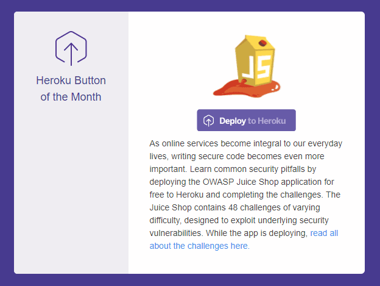

# Running OWASP Juice Shop

Part of [[01 Hacking preparations|Hacking preparations]]
← Previous: [[01 Hacking preparations|Hacking preparations]]
Next: [[03 Vulnerability Categories|Vulnerability Categories]] →

## System requirements

To run a single instance of Juice Shop the following memory and CPU requirements apply. These resources are needed for the Juice Shop application process itself, and they are based on empirical metrics collected from 101 active instances during a workshop on a [[06 Trainer's guide|MultiJuicer]] cluster with `v20.3.0` in October 2026.

Please note that any additional resources needed by your environment (e.g. Docker or Vagrant) come on top.

- **Minimum** system specification

  - `256 MB` RAM

  - `50 millicpu` CPU

  - `300 MB` free disk space

- **Recommended** system specification

  - `384 MB` RAM

  - `150 millicpu` CPU

  - `800 MB` free disk space

🗄️ *If installing [from sources](#_from_sources) without the `--depth 1` option, an additional `700 MB` free disk space are required for the Git history in both minimum and recommended spec.*

## Run options

|  |  |
|---|---|
|  | Juice Shop requires an external AI/LLM provider for its chatbot feature. See [AI/LLM Provider](#_aillm_provider) for setup instructions. |

In the following sections you find step-by-step instructions to deploy a running instance of OWASP Juice Shop for your personal hacking endeavours.

### Local installation

To run the Juice Shop locally you need to have [Node.js](http://nodejs.org/) installed on your computer. The Juice Shop officially runs on versions 22.x, 24.x, and 26.x of Node.js, closely following the official [Node.js Long-term Support Release Schedule](https://github.com/nodejs/LTS). During development and Continuous Integration (CI) the application is automatically tested with these current versions of Node.js. The officially recommended version to run Juice Shop is either the most recent *Long-term Support (LTS)* version or the *Current Release* version. Therefore Juice Shop recommends Node.js 24.x for its own v20.3.0 release.

#### From sources

1. Install [Node.js](http://nodejs.org/) on your computer.

2. On the command line run `git clone https://github.com/juice-shop/juice-shop.git --depth 1`.

3. Go into the cloned folder with `cd juice-shop`

4. Run `npm install`. This only has to be done before the first start or after you changed the source code.

5. Run `npm start` to launch the application.

6. Browse to [http://localhost:3000](http://localhost:3000)

#### From pre-packaged distribution

1. Install a 64bit [Node.js](http://nodejs.org/) on your Windows, MacOS or Linux machine.

2. Download `juice-shop-<version>_<node-version>_<os>_x64.zip` (or `.tgz`) attached to the [latest release on GitHub](https://github.com/juice-shop/juice-shop/releases/latest).

3. Unpack the archive and run `npm start` in unpacked folder to launch the application

4. Browse to [http://localhost:3000](http://localhost:3000)

### Docker image

You need to have [Docker](https://www.docker.com/) installed to run Juice Shop as a container inside it. Following the instructions below will download the current stable version (built from `master` branch on GitHub) which internally runs the application on the currently recommended Node.js version 24.x.

1. Install [Docker](https://www.docker.com/) on your computer.

2. On the command line run `docker pull bkimminich/juice-shop` to download the `latest` image described above.

3. Run `docker run -d -p 127.0.0.1:3000:3000 bkimminich/juice-shop` to launch the container with that image.

4. Browse to [http://localhost:3000](http://localhost:3000).

If you are using Docker on Windows - inside a VirtualBox VM - make sure that you also enable port forwarding from host `127.0.0.1:3000` to `0.0.0.0:3000` for TCP.

#### Supported architectures

The official Docker image is built automatically during CI/CD for `linux/amd64` (based on a Node.js 24.x image) as well as `linux/arm64` and `linux/arm/v7` (based on a Node.js 14 image) and both are pushed to DockerHub. The following tagged images are available on DockerHub:

- Stable version from `master` branch: `latest` for AMD/ARM64 and `latest-arm` for ARMv7

- Development version from `develop` branch: `snapshot` for AMD/ARM64 and `snapshot-arm` for ARMv7

- Tagged versioned releases: `vX.Y.Z` for AMD/ARM64 and `vX.Y.Z-arm` for ARMv7

### Vagrant

Vagrant is an open-source solution for building and maintaining virtual software development environments. It creates a Virtualbox VM that will launch a Docker container instance of the `latest` Juice Shop image v20.3.0.

1. Install [Vagrant](https://www.vagrantup.com/downloads.html) and [Virtualbox](https://www.virtualbox.org/wiki/Downloads)

2. Run `git clone https://github.com/juice-shop/juice-shop.git` (or clone [your own fork](https://github.com/juice-shop/juice-shop/fork) of the repository)

3. Run `cd vagrant && vagrant up`

4. Browse to [http://192.168.56.110](http://192.168.56.110)

### Kubernetes

The following will allow you to run Juice Shop in a Kubernetes Pod.

``` text
apiVersion: apps/v1
kind: Deployment
metadata:
  name: owasp-juice
spec:
  selector:
    matchLabels:
      app: juice
  replicas: 1
  template:
    metadata:
      labels:
        app: juice
    spec:
      containers:
      - name: juice
        image: bkimminich/juice-shop
        ports:
        - containerPort: 3000
```

Access the Web GUI with the `port-forward` command.

``` text
kubectl port-forward pod/NAME_OF_JUICE_POD 3000:3000
```

### Major Cloud Providers

#### Amazon EC2 Instance

You need to have an account at [Amazon Web Services](https://aws.amazon.com) in order to create a server hosting the Juice Shop there.

1. In the *EC2* sidenav select *Instances* and click *Launch Instance*

2. In *Step 1: Choose an Amazon Machine Image (AMI)* choose an *Amazon Linux AMI* or *Amazon Linux 2 AMI*

3. In *Step 3: Configure Instance Details* unfold *Advanced Details* and copy the script below into *User Data*

4. In *Step 6: Configure Security Group* add a *Rule* that opens port 80 for HTTP

5. Launch your instance

6. Browse to your instance’s public DNS

``` text
#!/bin/bash
yum update -y
yum install -y docker
service docker start
docker pull bkimminich/juice-shop
docker run -d -p 80:3000 bkimminich/juice-shop
```

##### AWS EC2 Launch Template

1. In the *EC2* sidenav select *Launch Templates* and click *Create launch template*

2. Under *Launch template contents* select as *AMI ID* either *Amazon Linux AMI* or *Amazon Linux 2 AMI* (by using *Search for AMI*)

3. In the same section add a *Security Group* that opens port 80 for HTTP

4. Unfold *Advanced details* at the bottom of the screen and paste in the script above into *User Data*

5. Create your launch template

6. Launch one or multiple EC2 instances from your template

7. Browse to your instance’s public DNS

#### Azure Container Instance

1. Open and login (via `az login`) to your [Azure CLI](https://azure.github.io/projects/clis/) **or** login to the [Azure Portal](https://portal.azure.com), open the *CloudShell* and then choose *Bash* (not PowerShell).

2. Create a resource group by running `az group create --name <group name> --location <location name, e.g. "centralus">`

3. Create a new container by running `az container create --resource-group <group name> --name <container name> --image bkimminich/juice-shop --dns-name-label <dns name label> --ports 3000 --ip-address public`

4. Your container will be available at [http://&lt;dns](http://%3Cdns)` name label>.<location name>.azurecontainer.io:3000`

##### Azure Web App for Containers

1. Open your [Azure CLI](https://azure.github.io/projects/clis/) **or** login to the [Azure Portal](https://portal.azure.com), open the *CloudShell* and then choose *Bash* (not PowerShell).

2. Create a resource group by running `az group create --name <group name> --location <location name, e.g. "East US">`

3. Create an app service plan by running `az appservice plan create --name <plan name> --resource-group <group name> --sku S1 --is-linux`

4. Create a web app with the [Juice Shop Docker](https://hub.docker.com/r/bkimminich/juice-shop/) image by running the following (on one line in the bash shell) `` az webapp create --resource-group <group name> --plan <plan name> ` `--name <app name> --deployment-container-image-name bkimminich/juice-shop ``

#### Google Compute Engine Instance

1. Login to the Google Cloud Console and [open Cloud Shell](https://console.cloud.google.com/home/dashboard?cloudshell=true).

2. Launch a new GCE instance based on the juice-shop container. Take note of the `EXTERNAL_IP` provided in the output.

``` text
gcloud compute instances create-with-container owasp-juice-shop-app --container-image bkimminich/juice-shop
```

1. Create a firewall rule that allows inbound traffic to port 3000

``` text
gcloud compute firewall-rules create juice-rule --allow tcp:3000
```

1. Your container is now running and available at [http://&lt;EXTERNAL_IP&gt;:3000/](http://%3CEXTERNAL_IP%3E:3000/)

### Other hosting providers

#### Heroku

To manually deploy OWASP Juice Shop on Heroku, follow these steps:

1. Install the Heroku CLI:

    - Download and install from the [Official Heroku CLI Installation Guide](https://devcenter.heroku.com/articles/heroku-cli).

    - Enable MFA in your Heroku account.

    - Log in via the command line: `heroku login -i`, using your Heroku email (username) and API key (password).

2. Clone your Juice Shop Repository and navigate to the juice-shop directory.

3. Run `heroku create` to create a Heroku Application.

4. Deploy Juice Shop to Heroku: `git add . && git commit -m "Deploy OWASP Juice Shop" && git push heroku master`

5. Access the deployed Juice Shop instance in the browser `heroku open`

|  |  |
|---|---|
|  | The `git add` and `git commit` steps are only required the first time or when new changes are made to the local repository. If you have already committed the changes you can skip those steps and directly run `git push heroku master` |

|  |  |
|---|---|
|  | If you have forked the Juice Shop repository, these steps will deploy your forked version of the application. To deploy the latest official version, clone the original repository from [https://github.com/juice-shop/juice-shop](https://github.com/juice-shop/juice-shop). |

|  |  |
|---|---|
|  | As a little related anecdote, the OWASP Juice Shop was crowned [Heroku Button of the Month in November 2017](https://hello.heroku.com/webmail/36622/679286305/8049a634b1a01b0aa75c0966325856dc9a463b7f1beeb6a2f32cbb30248b5bc6) and once more [in March 2019](https://hello.heroku.com/webmail/36622/844098776/9fe33b8eda9eb79bca7ee569888b1874): |



#### Railway

1. Sign up for an account on [Railway](https://railway.app/) and log in to your account.

2. Visit [https://railway.app/new/template/6JBGcJ](https://railway.app/new/template/6JBGcJ) to deploy Juice Shop on your Railway account.

|  |  |
|---|---|
|  | A step-by-step guide can be found in [this blog post](https://alphasec.io/practice-hacking-skills-with-owasp-juice-shop/). |

## Installing a specific release version

The installation instructions above will all give you the latest official release version of the Juice Shop. If you want to install a specific older version, you can easily do so by retrieving the corresponding tag from GitHub or Docker. For release v7.5.1 - which was the last version with the original AngularJS/Bootstrap frontend - for example:

- [From sources](#_from_sources) - Run `git fetch --tags` and then `git checkout v7.5.1` before running `npm install`

- [Docker image](#_docker_image) - Run `docker pull bkimminich/juice-shop:v7.5.1` instead of the usual `docker pull bkimminich/juice-shop`

- [From pre-packaged distribution](#_from_pre_packaged_distribution) - Just download the older release from [https://github.com/juice-shop/juice-shop/releases](https://github.com/juice-shop/juice-shop/releases) or [https://sourceforge.net/projects/juice-shop/files/](https://sourceforge.net/projects/juice-shop/files/)

To experience a preview of the next upcoming Juice Shop version you can do as follows:

- Simply visit [https://juice-shop-staging.herokuapp.com](https://juice-shop-staging.herokuapp.com) and take a look

- [From sources](#_from_sources) - Run `git fetch` and then `git checkout develop` before running `npm install`

- [Docker image](#_docker_image) - Run `docker pull bkimminich/juice-shop:snapshot` instead of the usual `docker pull bkimminich/juice-shop`

|  |  |
|---|---|
|  | Please be aware that support by the Project Leaders or community is limited (at best) for outdated and unreleased versions alike. To fully enjoy your OWASP Juice Shop experience, it is recommended to always use the latest version. |

## *Self-healing*-feature

OWASP Juice Shop was not exactly designed and built with a high availability and reactive enterprise-scale architecture in mind. It runs perfectly fine and fast when it is attacked via a browser by a human. When under attack by an automated tool - especially aggressive brute force scripts - the server might crash under the load. This could - in theory - leave the database and file system in an unpredictable state that prevents a restart of the application.

That is why - in practice - Juice Shop wipes the entire database and the folder users might have modified during hacking. After performing this *self-healing* the application is supposed to be restartable, no matter what kind of problem originally caused it to crash. For convenience the *self-healing* happens during the start-up (i.e. `npm start`) of the server, so no extra command needs to be issued to trigger it.

## Single-user restriction

There is one fundamental restriction that needs to be taken into account when working with the OWASP Juice Shop, especially in group trainings or lectures:

**A server instance of OWASP Juice Shop is supposed to be used by only a single-user!**

This restriction applies to all the [Run Options](#_run_options) explained above. It is technically necessary to make the [*Self-healing*-feature](#_self_healing_feature) work properly and consistently. Furthermore, when multiple users would attack the same instance of the Juice Shop all their progress tracking would be mixed leading to inevitable confusion for the individual hacker. The upcoming [[04 Challenge tracking|Challenge tracking]] chapter will illustrate this topic.

It should not go unmentioned that it is of course okay to have multiple users hack the same instance from a shared machine in a kind of *pair-hacking*-style.

If you want to centrally host Juice Shop instances for multiple users you find more information in section [[06 Trainer's guide|Hosting individual instances for multiple users]] of the trainer’s guide.

## Setting up external dependencies

### AI/LLM Provider

Juice Shop’s *AI Chat* requires an external LLM provider to function. By default, it connects to a local [Ollama](https://ollama.com) instance at [http://localhost:11434/v1](http://localhost:11434/v1).

To set up Ollama:

1. Install Ollama either via the [Desktop App](https://ollama.com) or via the [CLI installation instructions](https://ollama.com/download).

2. Pull the default model either via the Desktop App’s model search or using the CLI:

    ``` text
    ollama pull gemma4:e4b
    ```

3. Start Ollama (if not already running) and then launch Juice Shop as usual.

|  |  |
|---|---|
|  | `gemma4:e4b` is the recommended default model. It is the smallest model we found to work reliably enough to be useful, and should still run on most machines, even if slowly. |

You can configure an alternative OpenAI-compatible endpoint and model via the [[02 Customization|chatBot customization properties]] `llmApiUrl` and `model`. For authenticated endpoints, set the `LLM_API_KEY` environment variable with your API key.

|  |  |
|---|---|
|  | For the author the `stepfun/step-3.5-flash:free` model on [https://openrouter.ai/api/v1](https://openrouter.ai/api/v1). worked very well. It responded very fast even in tool-call-heavy conversations. After signing up, you can [create an API key in the OpenRouter dashboard](https://openrouter.ai/workspaces/default/keys). |

### Alchemy Ethereum Testnet

Two of Juice Shop’s Web3 challenges require a connection to an Ethereum testnet via the [Alchemy](https://alchemy.com) API. In order to reliably solve these challenges, you need to set up an Alchemy account and configure the API key in your Juice Shop instance:

1. Sign up for an account on [https://alchemy.com/](https://alchemy.com/) and log in to your dashboard.

2. Create an app in the Alchemy dashboard or use the one that is created by default.

3. In the *Endpoints* section, enable **Ethereum Sepolia** ([https://eth-sepolia.g.alchemy.com](https://eth-sepolia.g.alchemy.com)) as a network.

4. Copy your *API Key* and set it as an environment variable `ALCHEMY_API_KEY` for your Juice Shop instance

[[01 Hacking preparations|Hacking preparations]] [[03 Vulnerability Categories|Vulnerability categories]]

