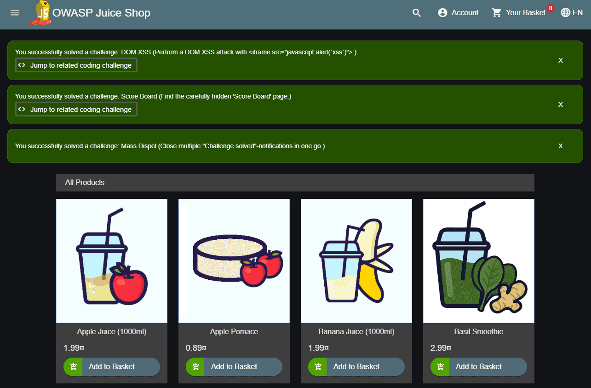
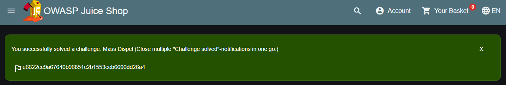

# Challenge tracking

Part of [[01 Hacking preparations|Hacking preparations]]
← Previous: [[03 Vulnerability Categories|Vulnerability Categories]]
Next: [[05 Hacking exercise rules|Hacking exercise rules]] →

## The Score Board

In order to motivate you to hunt for vulnerabilities, it makes sense to give you at least an idea what challenges are available in the application. Also, you should know when you actually solved a challenge successfully, so you can move on to another task. Both these cases are covered by the application’s score board.

On the score board you can view all available challenges with a brief description. Some descriptions are *very explicit* hacking instructions. Others are just *vague hints* that leave it up to you to find out what needs to be done.

![[part1-challenges-score-board_partly.png]]

The challenges are rated with a difficulty level between ⭐ and ⭐⭐⭐⭐⭐⭐, with more stars representing a higher difficulty. You can use the *Difficulty* filter to show or hide difficulty levels as you like. Hiding challenges has *no impact* on whether you can *solve* any of its challenges.

The difficulty ratings have been continually adjusted over time based on user feedback. The ratings allow you to manage your own hacking pace and learning curve significantly. When you pick a 5- or 6-star challenge you should *expect* a real challenge and should be less frustrated if you fail on it several times. On the other hand if hacking a 1- or 2-star challenge takes very long, you might realize quickly that you are on a wrong track with your chosen hacking approach.

Finally, each challenge states if it is currently *unsolved* or *solved*. The current overall progress is represented in percent in the *Hacking Challenges* progress bar on top left, and in absolute numbers grouped by difficulty in the top right panel of the score board. Especially in group hacking sessions this allows for a bit of competition between the participants. You can use the *Status* filter to change if only solved or unsolved or all challenges should be displayed. Especially after solving several challenges, hiding those helps to reduce the level of distraction on the Score Board.

![[part1-challenges-multi-hints1.png]]

If not deliberately turned off (see [[02 Customization|Customization]]) you can click on *Hints* button of each challenge to unlock a hint how to approach it.

![[part1-challenges-multi-hints2.png]]

Most challenges offer multiple hints that can be unlocked by further clicks on the button. To view the unlocked hints, just hover over the button.

![[part1-challenges-multi-hints3.png]]

### Challenge Filters

Additional to the filtering by difficulty and status, you can filter the Score Board by [[03 Vulnerability Categories|challenge categories]], e.g. to focus your hacking efforts on specific vulnerabilities. Use the toggle buttons under the dropdown filters to choose specific challenge categories, or select *All* to show all of them.

![[part1-challenges-score-board_category-filters.png]]

In the example above, only challenges in the Cross-Site Scripting (XSS) or XML External Entity (XXE) category would be shown.

### Challenge Tags

Starting with `v12.0.0` tags were introduced to help classify challenges which either favor a certain hacking approach or share some trait orthogonal to the categories.

- **AI / LLM** marks challenges that require the use of an AI language model to be solved

- **Brute Force** marks challenges where automation of some security tool or custom script is an option or even prerequisite

- **Code Analysis** marks challenges where it can be helpful to rummage through some source code of the application or a third party

- **Contraption** indicates that a challenge is not exactly part of a realistic scenario but might be a bit forced or crafted

- **Danger Zone** marks [potentially dangerous challenges](#_potentially_dangerous_challenges) which are disabled on Docker/Heroku by default due to RCE or other risks

- **Good for Demos** highlights [[06 Trainer's guide|challenges which are suitable for live demos]] or awareness trainings

- **Good Practice** highlights challenges which are less about vulnerabilities but promoting good (security) practices

- **OSINT** marks challenges which require some Internet research or *social stalking* activity outside the application

- **Prerequisite** marks challenges which need to be solved before one or more other challenges can be (realistically) solved

- **Requires {{dependency}}** marks challenges strictly depending on an external service, local endpoint, or API key in order to be solvable

- **Shenanigans** marks challenges which are not considered serious and/or realistic but exist more for entertainment

- **Tutorial** marks challenges for which a [Hacking Instructor script](#_hacking_instructor) exists to assist newcomers

- **Web3** marks challenges which incorporate Web3 concepts or technology such as Blockchain, Crypto Currency, Smart Contracts, or NFT

- **With Coding Challenge** marks a challenge that contains an associated coding challenge

![[part1-challenges-tags.png]]

You can filter challenges by tags using the *Tags* filter, which works similar to the previously described dropdown filters for difficulty and status.

## Free-text search

On top of the various dropdown and toggle filters, you can also filter the challenges on the Score Board with the free-text *Search* field. While you type into it, the Score Board will filter on-the-fly for challenges with your search string in either challenge name or description.

![[part1-challenges-score-board_search-filter.png]]

In the example above, the Score Board shows three challenges with `crypt` in either their name and/or description.

## Success notifications

The OWASP Juice Shop employs a simple yet powerful gamification mechanism: Instant success feedback! Whenever you solve a hacking challenge, a notification is *immediately* shown on the user interface.



This feature makes it unnecessary to switch back and forth between the screen you are attacking, and the score board to verify if you succeeded. Some challenges will force you to perform an attack outside of the Juice Shop web interface, e.g. by interacting with the REST API directly. In these cases the success notification will light up when you come back to the regular web UI the next time.

To make sure you do not miss any notifications they do not disappear automatically after a timeout. You have to dismiss them explicitly. In case a number of notifications "piled up" it is not necessary to dismiss each one individually, as you can simply `Shift`-click one of their *X*-buttons to dismiss all at the same time.

Depending on your application configuration, each challenge notification might also show a 🏁 symbol with a character sequence next to it. If you are doing a hacking session just on your own, you can completely ignore this flag. The code is only relevant if you are participating in a CTF event. Please refer to chapter [[04 Hosting a CTF event|Hosting a CTF event]] for more information this topic.



Apart from the success notifications, OWASP Juice Shop also fires a confetti cannon on each side of the screen whenever a user solves a hacking challenge.

![[part1-challenges-confetti1.png]]

## Automatic saving and restoring hacking progress

The [[02 Running OWASP Juice Shop|self-healing feature]] - by wiping the entire database on server start - of Juice Shop was advertised as a benefit just a few pages before. This feature comes at a cost, though: As the challenges are also part of the database schema, they will be wiped along with all the other data. This means, that after every restart you start with a clean 0% score board and all challenges in *unsolved* state.

To keep the resilience against data corruption but allow users to *pick up where they left off* after a server restart, your hacking progress is automatically saved whenever you solve a challenge - as long as you allow Browser cookies!

After restarting the server, once you visit the application your hacking progress is automatically restored:

![[part1-challenges-autorestore-hacking-progress.png]]

The auto-save mechanism keeps your progress for up to 30 days after your previous hacking session. When the score board is restored to its prior state, a torrent of success notifications will light up - depending on how many challenges you solved up to that point. As mentioned earlier these can be bulk-dismissed by `Shift`-clicking any of the *X*-buttons.

If you want to start over with a fresh hacking session, simply click the *Delete cookie to clear hacking progress* button. After the next server restart, your score board will be blank.

## Manual progress and settings backup

When clicking the cog button on the Score Board, you open an *Additional Score Board Settings* dialog.

![[part1-challenges-score-board_settings.png]]

With its *Save Backup* and *Restore Backup* buttons you can save and later restore your hacking progress as well as language, and banner dismissal status to a `JSON` file.

![[part1-challenges-manual_backup.png]]

The backup format is independent of your system or browser, meaning you can use the backup file to conveniently transfer your progress and settings from one computer to another. Example:

``` highlightjs
{
  "version": 1,
  "banners": {
    "welcomeBannerStatus": "dismiss",
    "cookieConsentStatus": "dismiss"
  },
  "language": "de_DE",
  "continueCode": "BzxDd5...G59p",
  "continueCodeFindIt": "MQOwgngy...XvqMVbWYyn",
  "continueCodeFixIt": "6On8VyX...jBEp5mN"
}
```

When the backup restore is successful, you must click "Apply changes now" in the corresponding message to trigger the hacking progress restore as well as the language changes in backend data.

![[part1-challenges-manual_backup-restore.png]]

If you do not click that button before the message vanishes, you can also restart your application server to apply the backup of hacking progress.

If during restore you see an error message `Version X is incompatible with expected version Y` your backup was taken before a semantically incompatible format change. The current backup schema version is 1.

## Hacking Instructor

![[part1-challenges-JuicyBot_MedicalMask.png]]

The built-in *Hacking Instructor* offers tutorials for some Juice Shop challenges. By default, the welcome banner shown upon first launch of the application has a 🎓-button which will help you [[02 Finding the Score Board|Find the carefully hidden 'Score Board' page]].

![[part1-challenges-welcome-banner.png]]

On the Score Board itself you will then find similar 🎓-buttons on some challenges which will launch a corresponding tutorial for each as well. All tutorials consist of a scripted sequence of helpful hints and instructions.

![[part1-challenges-hacking-instructor_1.png]]

The scripts often provide some interaction, like waiting for the user to make some specific input or having them visit another dialog before continuing. Some hints or instructions can be skipped by just clicking on them.

![[part1-challenges-hacking-instructor_2.png]]

After successfully completing all steps of a tutorial, the Hacking Instructor will usually congratulate you and then go into hiding until summoned again for another hacking challenge via the Score Board.

![[part1-challenges-hacking-instructor_3.png]]

|  |  |
|---|---|
|  | The Hacking Instructor is a tool to help beginners getting started. It cannot offer a tutorial for *every challenge* as some are too complex or require too many steps outside the application. In Part III you can learn more about how to write [[01 Hacking Instructor tutorial scripts\|Hacking Instructor tutorial scripts]]. |

### Tutorial mode

When using the Juice Shop in a classroom setup the trainer or teacher might want to set a slower pace at the beginning to give everyone a chance to get familiar with the application. Here the `tutorial.yml` configuration can be very useful, which is available since `v10.2.0` of Juice Shop. This mode hides all challenges without tutorials from the Score Board and disables all advanced filter options. In the tutorial mode challenges are only gradually unlocked by difficulty tiers.

![[part1-challenges-tutorial-mode1.png]]

Only when for example all 1-star challenges with a tutorial have been solved, the 2-star challenges with tutorials are displayed:

![[part1-challenges-tutorial-mode2.png]]

After solving **all** challenges with tutorials, the entire Score Board with all challenges is shown and all filters are enabled. Passing in the `NODE_ENV=tutorial` environment variable will activate this mode.

![[part1-challenges-tutorial-mode3.png]]

## Coding challenges

For 35 challenges, an additional button is available on the Score Board which
will open a dialog containing the actual code snippet responsible for the security vulnerability behind the particular challenge. Note that by default this button is only enabled for solved hacking challenges. For challenges where no such button is shown, there is no coding challenge available.

![[part1-challenges-code_snippet1.png]]

This snippet is loaded in real-time from the running application’s actual code base and is sanitized to not show any "challenge check" or similar code that would not be present in a real-world application.

![[part1-challenges-code_snippet2.png]]

The user can try to identify the actual line(s) of code responsible for the vulnerability behind the particular challenge. When they submit their selection, the server will provide feedback on the choice.

![[part1-challenges-code_snippet3.png]]

If the correct line(s) were submitted, the user will be presented with 3-4 possible options to fix the vulnerability. They can use the built-in code comparison to view them and then make a selection of what they think to be the correct fix. Submitting their choice to the server will again lead to feedback.

![[part1-challenges-code_snippet4.png]]

The progress with coding challenges is separately tracked in its own *Coding Challenges* percentage bar at the top of the Score Board. In the absolute progress shown in the *Challenges Solved* panel, coding challenges are included with both their phases. For each individual coding challenge, the current status is represented by the button to launch it. Once the "Find It" and "Fix It" part are solved, the button turns green. While only the "Find It" part was solved, a small green "1/2"-badge indicates having made it half-way.

![[part1-challenges-code_snippet5.png]]

When either of the two steps is solved correctly, the confetti cannons fire both barrels to celebrate the user’s success.

![[part1-challenges-confetti2.png]]

## Mitigation links

For many solved challenges links to mitigation techniques are presented on the Score Board. Where available they typically lead to a corresponding [OWASP Cheat Sheet](https://cheatsheetseries.owasp.org/) explaining how to avoid that kind of vulnerability in the first place.

![[part1-challenges-mitigation_links.png]]

## Potentially dangerous challenges

Some challenges can cause potential harm or pose some danger for your computer, i.e. the XXE, SSTi and Deserialization challenges as well as two of the NoSQLi challenges, and the possibility of an arbitrary file write. These simply cannot be sandboxed in a 100% secure way. These are only dangerous if you use actually malicious payloads, so please do not play with payloads you do not fully understand. Furthermore, be aware all stored XSS vulnerabilities can - by their nature - be abused to perform harmful attacks on unsuspecting visitors.

![[part1-challenges-dangerous-challenges_banner.png]]

For safety reasons all potentially dangerous challenges are disabled (along with their underlying vulnerabilities) when a containerized environment is detected. By default, this applies to Docker and Heroku. Dangerous challenges are marked as 'unavailable' in the scoreboard as can be seen in the screenshot below.

![[part1-challenges-dangerous-challenge_disabled.png]]

To re-enable all challenges you can set the environment variable `NODE_ENV=unsafe`, or you can set `safetyMode: disabled` in your own [[02 Customization|YAML configuration file]]. ☠️ **Please use the unsafe mode at your own risk**, especially on publicly hosted instances.

[[03 Vulnerability Categories|Vulnerability categories]] [[05 Hacking exercise rules|Hacking exercise rules]]

