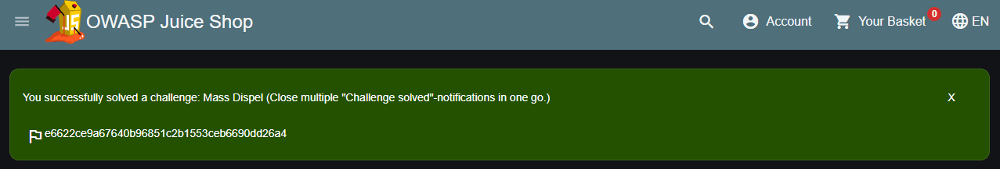

# Hosting a CTF event

← Previous: [[03 Hosting platform for multiple users|Hosting platform for multiple users]]
Next: [[05 Setting up the Juice Shop Lego Tower|Setting up the Juice Shop Lego Tower]] →

> In computer security, Capture the Flag (CTF) is a computer security competition. CTF contests are usually designed to serve as an educational exercise to give participants experience in securing a machine, as well as conducting and reacting to the sort of attacks found in the real world. Reverse-engineering, network sniffing, protocol analysis, system administration, programming, and cryptanalysis are all skills which have been required by prior CTF contests at DEF CON. There are two main styles of capture the flag competitions: attack/defense and jeopardy.
>
> In an attack/defense style competition, each team is given a machine (or a small network) to defend on an isolated network. Teams are scored on both their success in defending their assigned machine and on their success in attacking the other team’s machines. Depending on the nature of the particular CTF game, teams may either be attempting to take an opponent’s flag from their machine or teams may be attempting to plant their own flag on their opponent’s machine. Two of the more prominent attack/defense CTF’s are held every year at DEF CON, the largest hacker conference, and the NYU-CSAW (Cyber Security Awareness Week), the largest student cyber-security contest.
>
> Jeopardy-style competitions usually involve multiple categories of problems, each of which contains a variety of questions of different point values and difficulties. Teams attempt to earn the most points in the competition’s time frame (for example 24 hours), but do not directly attack each other. Rather than a race, this style of game play encourages taking time to approach challenges and prioritizes quantity of correct submissions over the timing.[^1]

![[part4-ctf-JuiceShopCTF_Logo.png]]

OWASP Juice Shop can be run in a special configuration that allows to use it in Capture-the-flag (CTF) events. This can add some extra motivation and fun competition for the participants of a security training or workshop.

## Running Juice Shop in CTF-mode

Juice Shop supports *Jeopardy-style CTFs* by generating a unique *CTF flag code* for each solved challenge.



These codes are not displayed by default, but can be made visible by running the application with the `config/ctf.yml` configuration:

``` highlightjs
set NODE_ENV=ctf     # on Windows
export NODE_ENV=ctf  # on Linux

npm start
```

On Linux you can also pass the `NODE_ENV` in directly in a single command

``` highlightjs
NODE_ENV=ctf npm start
```

When running the application as a Docker container instead execute

``` highlightjs
docker run -d -e "NODE_ENV=ctf" -p 127.0.0.1:3000:3000 bkimminich/juice-shop
```

The `ctf.yml` configuration furthermore hides the GitHub ribbon in the top right corner of the screen. It also hides all hints from the score board. Instead it will make the *solved*-labels on the score board clickable which results in the corresponding *"challenge solved!"*-notification being repeated. This can be useful in case you forgot to copy a flag code before closing the corresponding notification.

![[part4-ctf-repeat_notification.png]]

### Overriding the `ctf.key`

Juice Shop uses the content of the provided `ctf.key` file as the secret component of the generated CTF flag codes. If you want to make sure that your flag codes are not the same for every hosted CTF event, you need to override that secret key.

The simplest way to do so, is by providing an alternative secret key via the `CTF_KEY` environment variable:

``` highlightjs
set CTF_KEY=xxxxxxxxxxxxxxx     # on Windows
export CTF_KEY=xxxxxxxxxxxxxxx  # on Linux
```

or when using Docker

``` highlightjs
docker run -d -e "CTF_KEY=xxxxxxxxxxxxxxx" -e "NODE_ENV=ctf" -p 127.0.0.1:3000:3000 bkimminich/juice-shop
```

## CTF event infrastructure

The pivotal point of any Jeopardy-style CTF event is a central score-tracking server. It manages the status of the CTF, typically including

- registration dialogs for teams and users

- leader board of users/teams participating in the event

- challenge board with the open/solved hacking tasks and their score value

- which challenges have been solved already and by whom

Apart from the score-tracking server, each participant must have their own instance of OWASP Juice Shop. As explained in the [[02 Running OWASP Juice Shop|Single-user restriction]] section, having a shared instance for each team is strongly discouraged, because Juice Shop is programmed as a single-user application.

If you want to centrally host Juice Shop instances for any number of CTF participants we recommend using [[03 Hosting platform for multiple users|our own Multi Juicer platform]].

It is absolutely important that all Juice Shop instances participating in a CTF use the same [secret key to generate their CTF flag codes](#_overriding_the_ctf_key). The score server must be set up accordingly to accept exactly those flag codes for solving the hacking challenges and allocating their score to the first team/user that solved it.

As long as the flag code key is identical for all of them, it does not matter which run option for the Juice Shop each participant uses: Local Node.js, Docker container or Heroku/Amazon EC2 instances all work fine as they are independently running anyway! *There is no runtime dependency to the score server* either, as participants simply enter the flag code they see upon solving a challenge manually somewhere on the score server’s user interface, typically via their browser:

![[part4-ctf-CTF_Infrastructure.png]]

## Setting up CTF score servers for Juice Shop

Juice Shop comes with [the convenient `juice-shop-ctf-cli` tool](https://github.com/juice-shop/juice-shop-ctf) to to simplify the hosting of CTFs using popular open source frameworks or game servers. This can significantly speed up your setup time for an event, because things like using the same secret key for the flag codes are taken care of mostly automatic.

### Generating challenge import files with `juice-shop-ctf-cli`

The [`juice-shop-ctf-cli`](https://www.npmjs.com/package/juice-shop-ctf-cli) is a simple command line tool, which will generate a file compatible with your chosen CTF framework’s data backup format. This can be imported to populate its database and generate mirror images of all current Juice Shop challenges on the score server. The following instructions were written for v12.0.0 of `juice-shop-ctf-cli`.

To install `juice-shop-ctf-cli` you need to have Node.js 8.x or higher installed. Simply execute

``` highlightjs
npm install -g juice-shop-ctf-cli
```

and then run the tool with

``` highlightjs
juice-shop-ctf
```

The tool will now ask a series of questions. All questions have default answers available which you can choose by simply hitting `ENTER`.

![[part4-ctf-cli_usage_screenshot.png]]

1. **CTF framework to generate data for?** Offers a selectable choice between the supported CTF frameworks, which for v12.0.0 are

    - `CTFd` which is a very well-written and stable piece of Open Source Software. This is the default choice.

    - `FBCTF` from Facebook which is visually more advanced though not as frequently updated as CTFd.

    - `RootTheBox` a very sophisticated framework which comes even with category logos and embedded Juice Shop theme.

2. **Juice Shop URL to retrieve challenges?** URL of a *running* Juice Shop server where the tool will retrieve the existing challenges from via the `/api/Challenges` API. Defaults to `https://juice-shop.herokuapp.com` which always hosts the latest official released version of OWASP Juice Shop.

3. **Secret key or URL to ctf.key file?** Either a single secret key to use for the CTF flag codes *or* a URL to a file containing such a key *or* a comma-separated list of keys (only for CTFd). Defaults to [https://raw.githubusercontent.com/juice-shop/juice-shop/master/ctf.key](https://raw.githubusercontent.com/juice-shop/juice-shop/master/ctf.key) which is the key file provided with the latest official OWASP Juice Shop release. See [Overriding the `ctf.key`](#_overriding_the_ctf_key) for more information.

4. **URL to country-mapping.yml file?** URL of a mapping configuration of challenges to countries, which is only asked when `FBCTF` was selected. Defaults to `https://raw.githubusercontent.com/juice-shop/juice-shop/master/config/fbctf.yml`

5. **Insert a text hint along with each challenge?** Offers a selectable choice between

    - `No hints` will not add any hints to the challenges. This is the default choice.

    - `Free hints` will add the `Challenge.hint[]` items from the Juice Shop database as hints to the corresponding challenge on the CTF score server. Viewing these hints is free.

    - `Paid hints` adds the hints per challenge like described above. Viewing each of these hints costs the team 10% of that challenge’s score value on CTFd and RTB. On FBCTF only a single hint per challenge is supported, so the hints are merged into one and the costs added up.

The category of each challenge is identical to its [[03 Vulnerability Categories|category in the Juice Shop]] database. The score value and optional costs for hints of each challenge are calculated by the `juice-shop-ctf-cli` program as follows:

| Difficulty | Score value | Paid costs (per hint) |
|---|---|---|
| ⭐ | 100 points | 10 |
| ⭐⭐ | 250 points | 25 |
| ⭐⭐⭐ | 450 points | 45 |
| ⭐⭐⭐⭐ | 700 points | 70 |
| ⭐⭐⭐⭐⭐ | 1000 points | 100 |
| ⭐⭐⭐⭐⭐⭐ | 1350 points | 135 |

The generated output of the tool will finally be written into in the folder the program was started in. By default the output files are named `OWASP_Juice_Shop.YYYY-MM-DD.CTFd.csv`, `OWASP_Juice_Shop.YYYY-MM-DD.FBCTF.json` or `OWASP_Juice_Shop.YYYY-MM-DD.RTB.xml` depending on your initial framework choice.

Optionally you can choose the name of the output file with the `--output` parameter on startup:

``` text
juice-shop-ctf --output challenges.out
```

#### Non-interactive generator mode

Instead of answering questions in the CLI you can also provide your desired configuration in a file with the following straightforward format:

``` highlightjs
ctfFramework: CTFd | FBCTF | RootTheBox
juiceShopUrl: https://juice-shop.herokuapp.com
ctfKey: https://raw.githubusercontent.com/juice-shop/juice-shop/master/ctf.key # can also be actual key instead URL or comma-separated list of keys (only for CTFd)
countryMapping: https://raw.githubusercontent.com/juice-shop/juice-shop/master/config/fbctf.yml # ignored for CTFd and RootTheBox
insertHints: none | free | paid
```

You can then pass this YAML file into the CLI the generator with the `--config` parameter:

``` text
juice-shop-ctf --config myconfig.yml
```

As in interactive mode, you can also choose the name of the output file with the `--output` parameter:

``` text
juice-shop-ctf --config myconfig.yml --output challenges.out
```

### Running CTFd

![[part4-ctf-ctfd_logo.png]]

This setup guide assumes that you use CTFd 3.7 or higher. To apply the generated `.csv`, follow the steps describing your preferred CTFd run-mode below.

#### Local server setup

1. Get CTFd with `git clone https://github.com/CTFd/CTFd.git`.

2. Run `git checkout tags/<version>` to retrieve version 3.7 or higher.

3. Perform steps 1 and 3 from [the CTFd installation instructions](https://github.com/CTFd/CTFd#install).

4. Browse to your CTFd instance UI (by default [http://127.0.0.1:4000](http://127.0.0.1:4000)) and perform the basic *Setup* filling out all mandatory information minimalistially (as it will be deleted during the import again) and clicking *Next* on each tab before the last. On the last tab click *Finish*.

5. Go to the section *Admin Panel* > *Config* > *Backup* and choose *Import CSV*

6. Select *Challenges* from the *CSV Type* dropdown

7. Select the generated `.csv` file as *CSV File* and press *Import*.

#### Docker container setup

1. Setup [Docker host and Docker compose](https://docs.docker.com/compose/install/).

2. Follow all steps from [the CTFd Docker setup](https://github.com/CTFd/CTFd/wiki/Basic-Deployment) to install Docker, download the source code, create containers (for 3.7 or higher) and start them.

3. After running `docker-compose up` from previous step, you should be able to browse to your CTFd instance UI (`<docker host IP>:8000` by default) and create an admin user and CTF name.

4. Follow the steps 5-7 from the [Local server setup](#_local_server_setup) described above.

##### Non-production Docker image

1. Install Docker

2. Run `docker pull ctfd/ctfd:<version>` the retrieve tag 3.7 or higher

3. Execute `docker run --rm -p 8000:8000 ctfd/ctfd:<version>` to run 3.7 or higher

4. Follow the steps 5-7 from the [Local server setup](#_local_server_setup) described above

Once you have CTFd up and running, you should see all the created data in the *Challenges* tab:

![[part4-ctf-ctfd_1.png]]

![[part4-ctf-ctfd_2.png]]

![[part4-ctf-ctfd_3.png]]

![[part4-ctf-ctfd_4.png]]

### Running FBCTF

![[part4-ctf-fbctf_logo.jpg]]

Please note that Facebook does not publish any versioned releases of FBCTF. They recommend to use the `master`-branch content from GitHub ([https://github.com/facebook/fbctf](https://github.com/facebook/fbctf)) in all their setup methods. There is also no official image on Docker Hub for FBCTF.

1. Follow any of the options described in the [FBCTF Quick Setup Guide](https://github.com/facebook/fbctf/wiki/Quick-Setup-Guide).

2. Browse to your FBCTF instance UI.

3. Click the *Controls* tab under the *Game Admin* panel.

4. Choose *Import Full Game* and select the generated `.json` file.

The following screenshots were taken during a CTF event where Facebook’s game server was used. Juice Shop instances were running in a Docker cluster and individually assigned to a participant via a load balancer.

![[part4-ctf-fbctf_1.png]]

![[part4-ctf-fbctf_2.png]]

![[part4-ctf-fbctf_3.png]]

![[part4-ctf-fbctf_4.png]]

### Running RootTheBox

![[part4-ctf-rtb_logo.png]]

1. Follow either the [Installation Tutorial](https://github.com/moloch--/RootTheBox/wiki/Installation) or [Docker Deployment](https://github.com/moloch--/RootTheBox/wiki/Docker-Deployment) guide to install RootTheBox version 3.3 or higher.

2. Log in with the admin credentials displayed during server start-up.

3. In the *Backup/Restore* menu select *Import XML* and select the generated `.xml` file.

4. You can now see the challenges under *Game Management* in *Flags / Boxes / Corps.*

The following screenshots show the look & feel of RootTheBox as it was imported from the XML which by default has all the banners and category logos embedded:

![[part4-ctf-rtb_0.png]]

![[part4-ctf-rtb_1.png]]

![[part4-ctf-rtb_2.png]]

![[part4-ctf-rtb_3.png]]

![[part4-ctf-rtb_4.png]]

## Using other CTF frameworks

[CTFd](https://ctfd.io), [FBCTF](https://github.com/facebook/fbctf) and [RootTheBox](https://github.com/moloch--/RootTheBox) are not the only possible score servers you can use. Open Source alternatives are for example [Mellivora](https://github.com/Nakiami/mellivora) or [NightShade](https://github.com/UnrealAkama/NightShade). You can find a nicely curated list of CTF platforms and related tools & resources in [Awesome CTF](https://github.com/apsdehal/awesome-ctf) on GitHub.

All these platforms have one thing in common: Unless you write a dedicated `lib/generators/`-file 😉, you have to set up the challenges inside them manually on your own. Of course you can choose aspects like score per challenge, description etc. like you want. For the CTF to *actually work* there is only one mandatory prerequisite:

The flag code for each challenge must be declared as the result of

``` text
HMAC_SHA1(ctfKey, challenge.name)
```

with `challenge.name` being the `name` column of the `Challenges` table in the Juice Shop’s underlying database. The `ctfKey` has been described in the [Overriding the `ctf.key`](#_overriding_the_ctf_key) section above.

Feel free to use [the implementation within `juice-shop-ctf-cli`](https://github.com/juice-shop/juice-shop-ctf/blob/master/lib/generateSql.js#L25) as an example:

``` highlightjs
var jsSHA = require('jssha')

function hmacSha1 (secretKey, text) {
  var shaObj = new jsSHA('SHA-1', 'TEXT')
  shaObj.setHMACKey(secretKey, 'TEXT')
  shaObj.update(text)
  return shaObj.getHMAC('HEX')
}
```

> In cryptography, a keyed-hash message authentication code (HMAC) is a specific type of message authentication code (MAC) involving a cryptographic hash function and a secret cryptographic key. It may be used to simultaneously verify both the data integrity and the authentication of a message, as with any MAC. Any cryptographic hash function, such as MD5 or SHA-1, may be used in the calculation of an HMAC; the resulting MAC algorithm is termed HMAC-MD5 or HMAC-SHA1 accordingly. The cryptographic strength of the HMAC depends upon the cryptographic strength of the underlying hash function, the size of its hash output, and on the size and quality of the key.
>
> An iterative hash function breaks up a message into blocks of a fixed size and iterates over them with a compression function. For example, MD5 and SHA-1 operate on 512-bit blocks. The size of the output of HMAC is the same as that of the underlying hash function (128 or 160 bits in the case of MD5 or SHA-1, respectively), although it can be truncated if desired.
>
> HMAC does not encrypt the message. Instead, the message (encrypted or not) must be sent alongside the HMAC hash. Parties with the secret key will hash the message again themselves, and if it is authentic, the received and computed hashes will match.[^2]

## Commercial use disclaimer

|  |  |
|---|---|
|  | With the increasing number of challenge solutions (this book included) available on the Internet, it might **not** be wise to host a professional CTF for prize money with OWASP Juice Shop! |

------------------------------------------------------------------------

[^1]: [https://en.wikipedia.org/wiki/Capture_the_flag#Computer_security](https://en.wikipedia.org/wiki/Capture_the_flag#Computer_security)

[^2]: [https://en.wikipedia.org/wiki/Hash-based_message_authentication_code](https://en.wikipedia.org/wiki/Hash-based_message_authentication_code)

[[03 Hosting platform for multiple users|Hosting platform for multiple users]] [[05 Setting up the Juice Shop Lego Tower|Juice Shop Lego Tower]]

